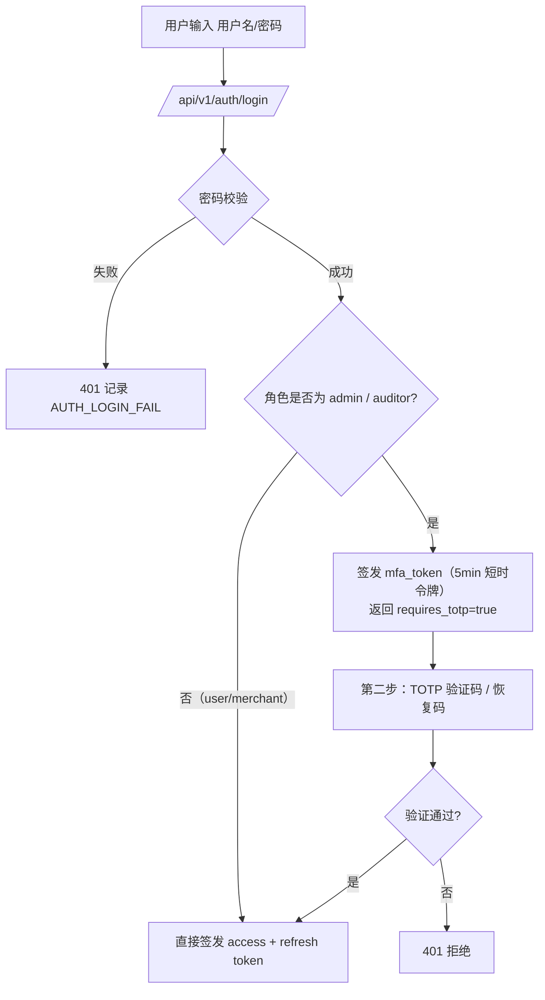
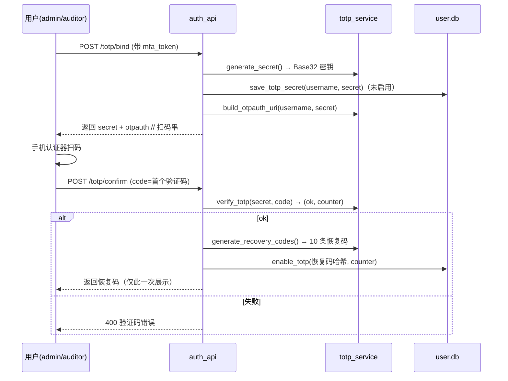
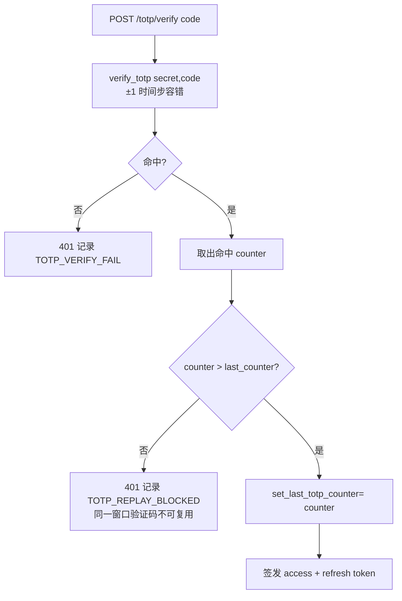
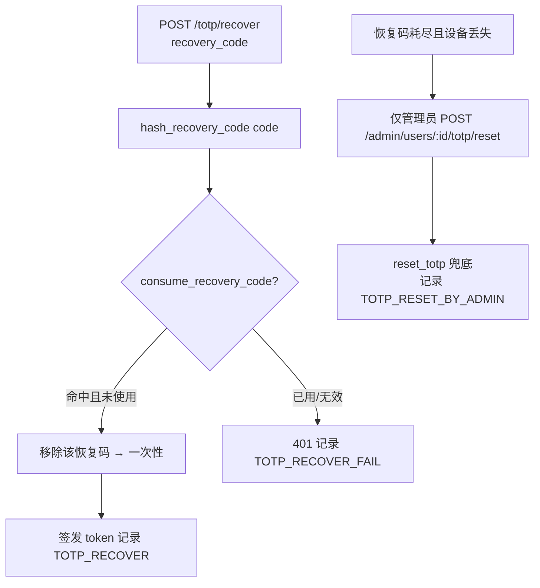

# 02 TOTP 双因素认证流程图

> 对应任务书第 2 周节点「RBAC 与 MFA 设计」中的「TOTP 流程图」交付物。
> 实现代码：`app/services/totp_service.py`（RFC 6238 TOTP / RFC 4226 HOTP）、
> `app/api/auth_api.py`（绑定/验证/恢复/禁用接口）。

## 1. 认证总体流程

> 管理员 / 审计员强制双因素（`auth_api.py:_TOTP_ROLES`），普通用户/商户单因素即可 —— 这是「按角色分级的 MFA 策略」。

## 2. TOTP 绑定流程（首次启用）

## 3. TOTP 验证（登录第二步，含防重放）

## 4. 恢复码兜底（设备丢失）

## 5. 算法参数（RFC 6238，与认证器兼容）

| 参数 | 值 |
| --- | --- |
| 哈希算法 | HMAC-SHA1 |
| 时间步长 `STEP` | 30 秒 |
| 码位数 `DIGITS` | 6 |
| 容错窗口 `WINDOW` | ±1 步（容忍 60s 时间偏差） |
| 恢复码数量 | 10 条（`AB12-CD34` 格式，只存 SHA-256 哈希） |

## 6. 验收要点对照

| 验收要点 | 落地 |
| --- | --- |
| 恢复流程有边界 | 验证码防重放（counter 严格递增）＋恢复码一次性（消费即删除）＋管理员代重置兜底 |
| 管理员关键操作可追溯 | 绑定/验证/恢复/禁用/重置均写审计日志（`TOTP_*` 事件） |
| 与实现一致 | `test_rbac.py` 的 `do_totp_bind_confirm_verify` 逐条断言绑定/防重放/登录成功 |
